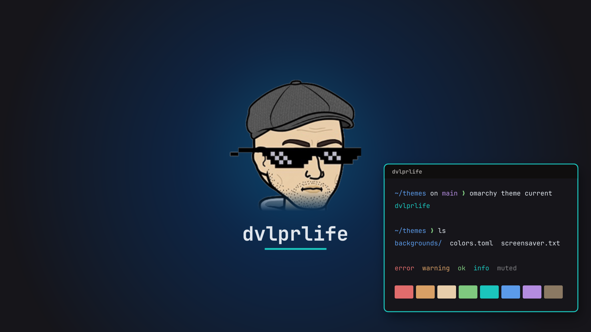
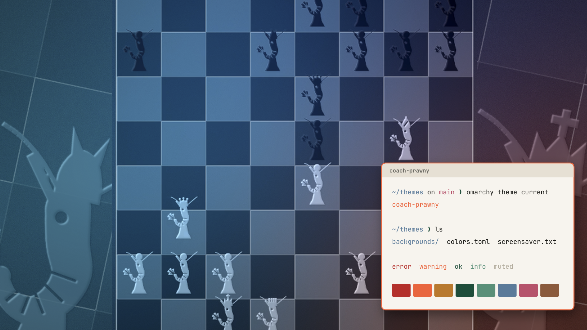

# omarchy-themes

Custom themes for [Omarchy](https://omarchy.org/), the Arch Linux and Hyprland setup.

| | |
|---|---|
| **dvlprlife** · dark | **Coach Prawny** · light |
|  |  |

## Themes

### dvlprlife

A dark theme built from the [dvlprlife](https://github.com/dvlprlife) avatar and dvlprlife.com:
banner charcoal background, site navy selection and teal accent, with skin and
beard tones from the avatar.

- **Wallpapers:** the avatar on a navy glow, and the pixel sunglasses on a pixel grid
- **Screensaver:** a `dvlprlife` wordmark
- **Icons:** Yaru-blue-dark

### Coach Prawny

A light theme from the [coachprawny.com](https://coachprawny.com) palette: paper,
ink, prawn orange and board green.

- **Wallpapers:** prawn chess pieces on a board, and a plain paper checkerboard
- **Screensaver:** a `COACH PRAWNY` wordmark
- **Icons:** Yaru-prussiangreen

## Install

This repo holds several themes, so `omarchy theme install <url>` won't work with it.
That command expects one theme per repo. Clone the repo and link the themes you want instead:

```bash
git clone https://github.com/dvlprlife/omarchy-themes.git ~/omarchy-themes

ln -s ~/omarchy-themes/dvlprlife ~/.config/omarchy/themes/dvlprlife
ln -s ~/omarchy-themes/coach-prawny ~/.config/omarchy/themes/coach-prawny

omarchy theme set dvlprlife
```

Because the themes are linked, `git pull` updates them. Run `omarchy theme set`
again to apply the changes.

## Screensaver per theme

Omarchy's screensaver shows a single file, `~/.config/omarchy/branding/screensaver.txt`,
whatever theme is active. To have it follow the theme, link the hook in
`hooks/theme-set.d/` once:

```bash
ln -s ~/omarchy-themes/hooks/theme-set.d/theme-screensaver.hook \
  ~/.config/omarchy/hooks/theme-set.d/theme-screensaver.hook
```

Each time you set a theme, the hook copies that theme's `screensaver.txt` into
place. Themes without one, including all the stock themes, get the Omarchy logo back.
Without the hook, the themes still work, and the screensaver keeps whatever it showed before.

The hook overwrites `screensaver.txt` on every theme change. If you set custom art
with `omarchy branding screensaver`, it is replaced the next time you switch themes.

## Theme files

| File | Purpose |
|------|---------|
| `colors.toml` | The palette. Omarchy generates the terminal, Hyprland, Neovim and VS Code configs from it. |
| `backgrounds/` | Wallpapers. Cycle them with `omarchy theme bg next`. |
| `screensaver.txt` | Screensaver art, used by the hook above. Keep it about 84 columns wide or less. |
| `icons.theme` | Icon theme name. |
| `chromium.theme` | Browser frame color as `R,G,B`. |
| `preview.png` | Shown in the Omarchy theme picker and this README. |

To make new screensaver art, render high-contrast text or a logo with
`omarchy transcode ascii <image> screensaver.txt --width 84 --mode block`.
To rebuild a preview after changing colors, run `tools/make-preview.py <theme>`.
It needs ImageMagick, `rsvg-convert` and JetBrainsMono Nerd Font.

## License

The color files, screensaver text, hook and tools are [MIT](LICENSE). The
wallpapers and previews, including the dvlprlife avatar, are not covered by that
license. All rights to them are reserved.
